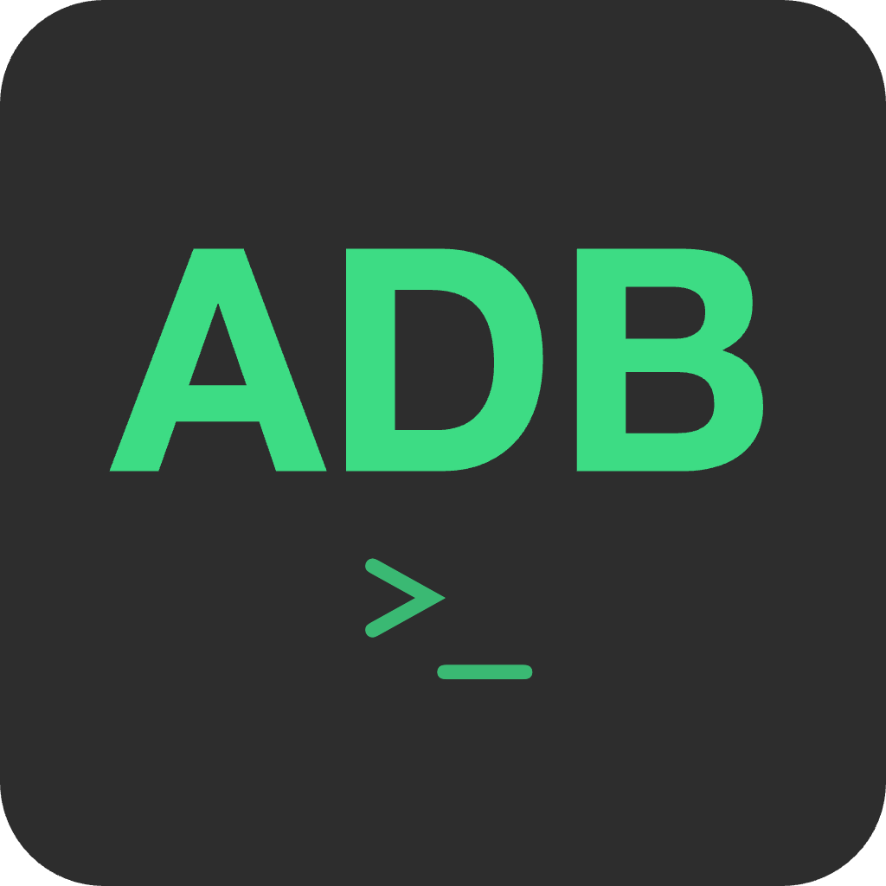
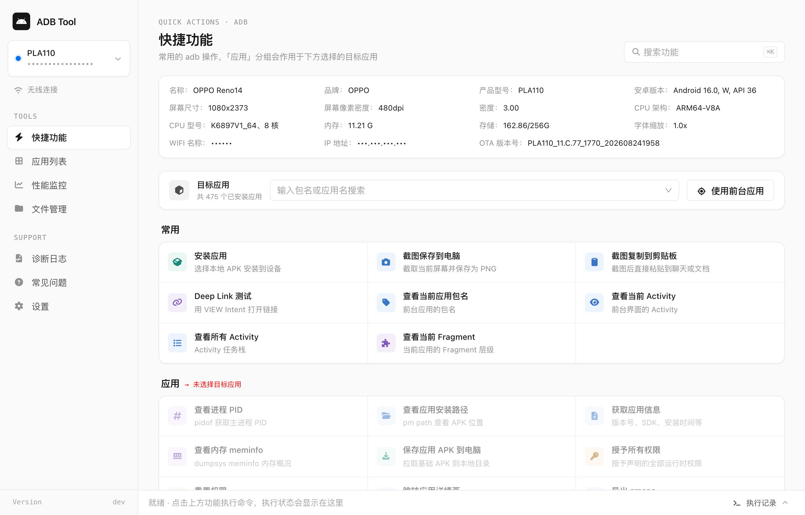
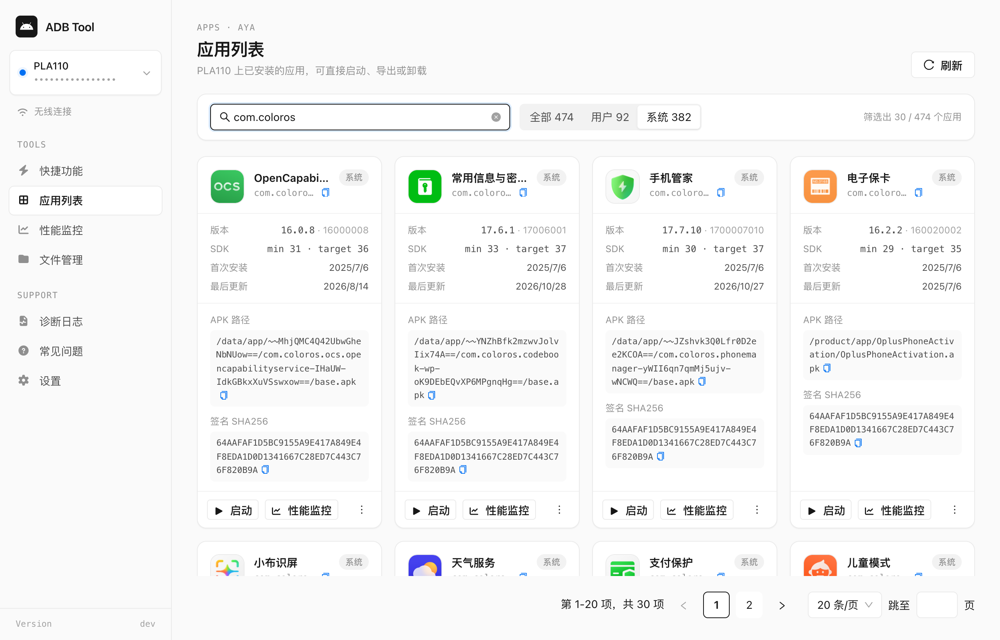
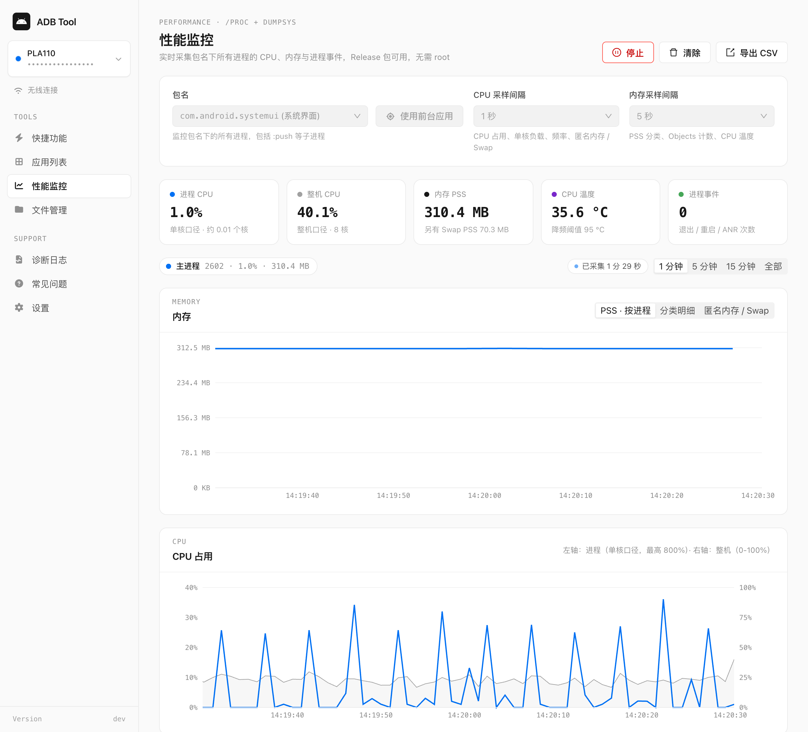
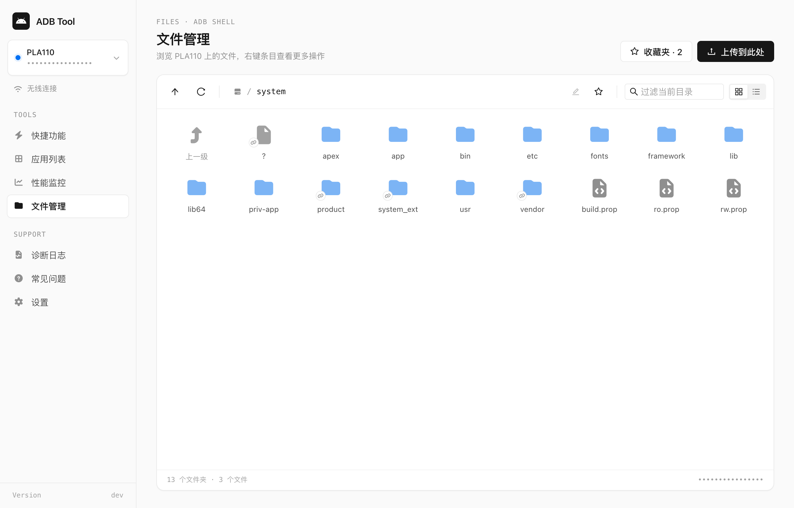
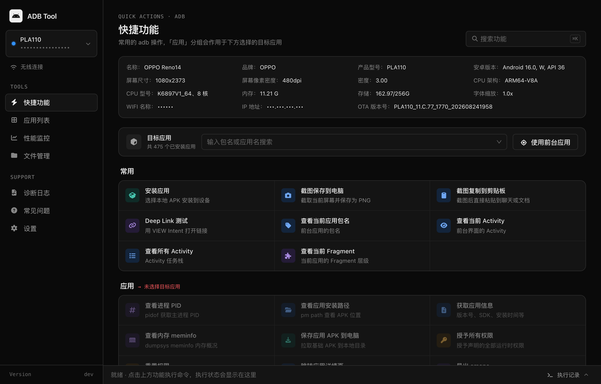
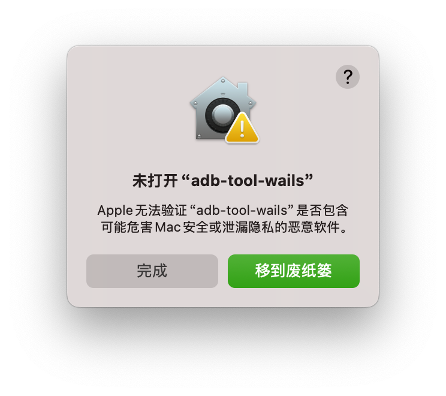
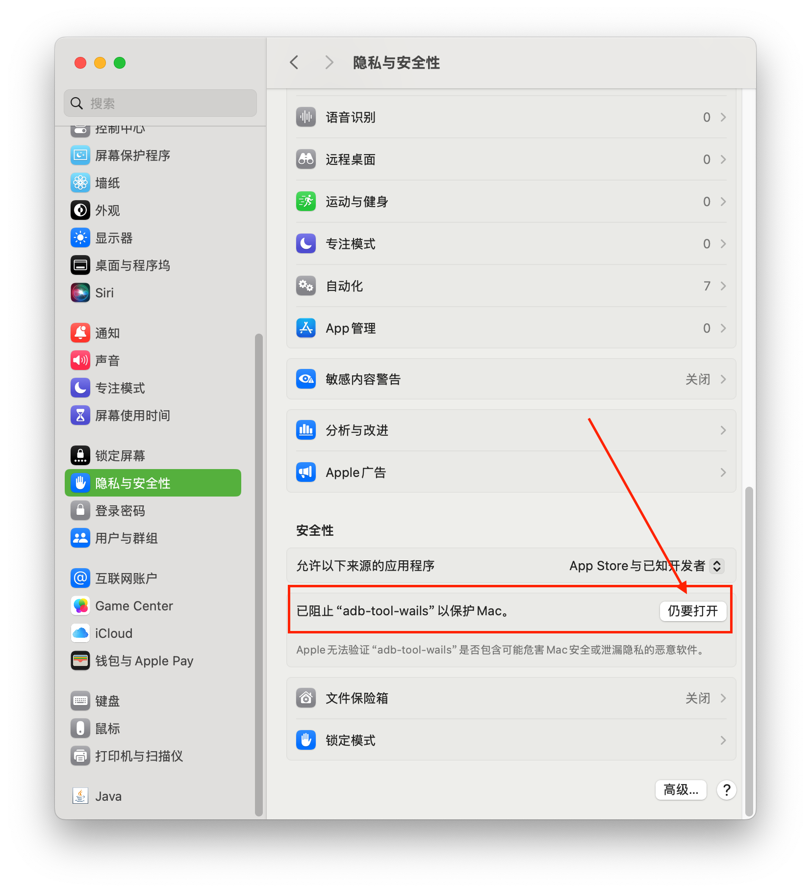

# ADB Tool

<div align="center">



A modern graphical interface for Android Debug Bridge (ADB) that makes debugging and managing Android devices simple and intuitive.

[简体中文](README.zh-CN.md) | **English**

[](https://github.com/ilpanda/adb-tool-wails/releases)
[](LICENSE)
[](https://wails.io)
[](https://golang.org)
[](https://reactjs.org)

[Features](#features) • [Getting Started](#getting-started) • [Roadmap](#roadmap)

</div>

The application supports English and Simplified Chinese. It follows the system language by default; you can change it in **Settings → Appearance → Language**. Other system languages fall back to English.



---

## Features

### Device Connectivity

- **Device list** - View connected devices in real time and quickly switch between them.
- **Device information** - View the model, Android version, display, CPU, memory, storage, OTA build number, and more. Click a value to copy it.
- **Wireless debugging** - Pair using a QR code or pairing code, connect by IP address, or switch a USB-connected device to wireless debugging (for Android 10 and earlier).

### Quick Actions

- **Action search** - Press `⌘K` / `Ctrl+K` to find actions quickly. View execution progress and results in the execution history at the bottom of the window.
- **Common actions** - Install APKs, save screenshots to your computer, copy screenshots to the clipboard, view the current Activity / Fragment, and more.
- **App actions** - Search for a target app or select the foreground app with one click, then launch, kill, restart, clear data, grant or reset permissions, export its APK, or uninstall it.
- **Debugging exports** - Export meminfo, smaps, showmap, hprof, and thread information. Inspect thread priorities and allowed CPU cores.
- **Deep link testing** - Open links with a VIEW Intent and see the launched Activity and startup time. Optionally restrict link resolution to the target app.
- **Quick settings** - Toggle GPU rendering profiles, overdraw visualization, and layout bounds. Open system settings pages such as Developer options, Wi-Fi, and Language.
- **Keys and system actions** - Send Home, Back, volume, and other key events; view system properties; reboot or shut down the device.

### App List

- Browse all installed apps (user and system apps), with search by app name or package name.
- View version and SDK information, installation and update times, APK paths, and SHA-256 signing certificate fingerprints.
- Launch an app, open performance monitoring, set it as the target for quick actions, export its APK, or uninstall it directly from the list.
- Apps are preloaded in the background after selecting a device. Large lists appear in batches so you can start browsing before loading finishes.



### Performance Monitoring

- Monitor all processes belonging to a package simultaneously, including the main process and subprocesses such as `:push`. No root access is required, and release builds are supported.
- **Memory** - Track PSS categories, anonymous memory, Swap, and object counts (Activities, Views, etc.). Inspect the full meminfo output for any sampled point in time.
- **CPU** - Track process CPU usage (relative to a single core) and overall device CPU usage. Hover to see the threads consuming the most CPU and per-core load.
- **Frequency and temperature** - View average frequencies over each sampling interval for each CPU cluster, CPU temperatures, and thermal throttling thresholds.
- **Process events** - Automatically detect process starts, exits, restarts, and ANRs, with reasons such as low memory, crashes, and force stops, annotated on the charts.
- Export data as CSV.



### File Management

- Browse device files, preview text and images, upload, download, delete, and bookmark frequently used directories.
- Drag files into the window to upload them to the current directory.



### More Features

- **Automatic ADB setup** - If adb is not detected, Google platform-tools are downloaded automatically in the background. No manual installation is needed.
- **Drag-and-drop installation** - Drop an APK into the window to install it. When downgrading, the app asks for confirmation before uninstalling and reinstalling.
- **Dark mode** - Choose system, light, or dark appearance.
- **In-app updates** - Check GitHub Releases at startup, download new versions in the background, and restart to finish updating. Downloads use the system proxy and automatically retry and resume after interruptions. On macOS, versions installed through in-app updates do not trigger the developer verification warning again.
- **Diagnostic logs** - View and export the tool's own runtime logs to help report issues.



---

## Roadmap

### Upcoming

- First-launch setup: check adb availability, device connectivity, and USB debugging authorization, with step-by-step guidance.
- Screen recording: record activity on the device screen.
- Hprof analysis: inspect View and Activity counts, their reference chains to GC roots, loaded classes, and more.

---

## Getting Started

### Prerequisites

- **ADB (optional)** - You do not need to install it in advance. If adb is missing from both the system PATH and the configured settings, the app automatically downloads Google platform-tools at startup. You can also install adb yourself or specify its path in Settings.
    - Windows: [Download Platform Tools](https://developer.android.com/tools/releases/platform-tools)
    - macOS: `brew install android-platform-tools`
    - Linux: `sudo apt install android-tools-adb`

- **USB debugging** - Enable USB debugging on your Android device:
    1. Open **Settings** → **About phone**.
    2. Tap **Build number** seven times to enable Developer options.
    3. Return to **Settings** → **Developer options** and enable **USB debugging**.

- **Wireless debugging (optional)** - On Android 11 and later, enable **Developer options** → **Wireless debugging**, then click Wireless connection in the app's left sidebar to pair. QR code pairing relies on mDNS; use pairing-code pairing if your computer and phone are on different network subnets.

### Installation

#### Option 1: Download a Prebuilt Release

Visit the [Releases page](https://github.com/ilpanda/adb-tool-wails/releases) and download the package for your operating system:

- **Windows**: `adb-tool-windows-amd64-installer.zip` (installer) or `adb-tool-windows-amd64-portable.zip` (portable).
- **macOS**: `adb-tool-macos-universal.tar.gz`.
- **Linux**: `adb-tool-linux-amd64.tar.gz`.

##### First Launch on macOS

Extract `adb-tool-macos-universal.tar.gz` and move the app to **Applications**.

Because the app is not notarized by Apple, macOS displays a security warning when you first open it. Follow these steps (the warning will not reappear for subsequent in-app updates):

**Step 1**: Open the app for the first time. When macOS displays the verification warning, click **Done** to close the dialog.



**Step 2**: Click the Apple icon in the upper-left corner and select **System Settings…**.

**Step 3**: Open **Privacy & Security**. In the Security section, find the blocked app, click **Open Anyway**, and enter your password to confirm.



#### Option 2: Build from Source

Install Go 1.26+, Node.js 20+, and the [Wails CLI](https://wails.io/docs/gettingstarted/installation) (v2.10.2) first. Linux also requires `libgtk-3-dev` and `libwebkit2gtk-4.0-dev`.

```bash
# Clone the repository
git clone https://github.com/ilpanda/adb-tool-wails.git
cd adb-tool-wails

# Install dependencies
go mod download
cd frontend && npm install && cd ..

# Build
wails build

# Run (on macOS, open build/bin/adb-tool-wails.app)
./build/bin/adb-tool-wails
```

#### Option 3: Local Development

Run Wails locally:

```bash
wails dev
```

If you modify the Aya server, rebuild it:

```bash
# Run from the project root
cd server
./gradlew :server:assembleRelease
```

The build automatically replaces `resources/aya.dex`. Remember to update:

- `versionName` and `versionCode` in `server/server/build.gradle`.
- `AyaDexVersion` in `internal/aya/client.go`.

Keep `AyaDexVersion` and `versionName` in sync.

---

### References

This project's implementation draws on the following repositories:

1. [liriliri/aya](https://github.com/liriliri/aya)
2. [wkbin/AdbFileManager](https://github.com/wkbin/AdbFileManager)
3. [EaniaHuui/android_tool](https://github.com/EaniaHuui/android_tool)
