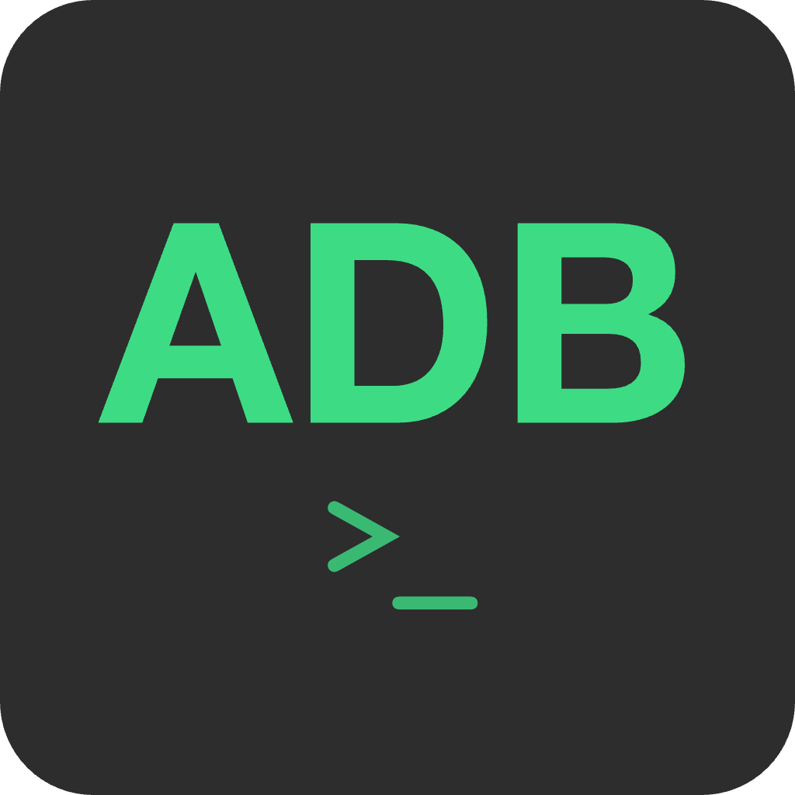
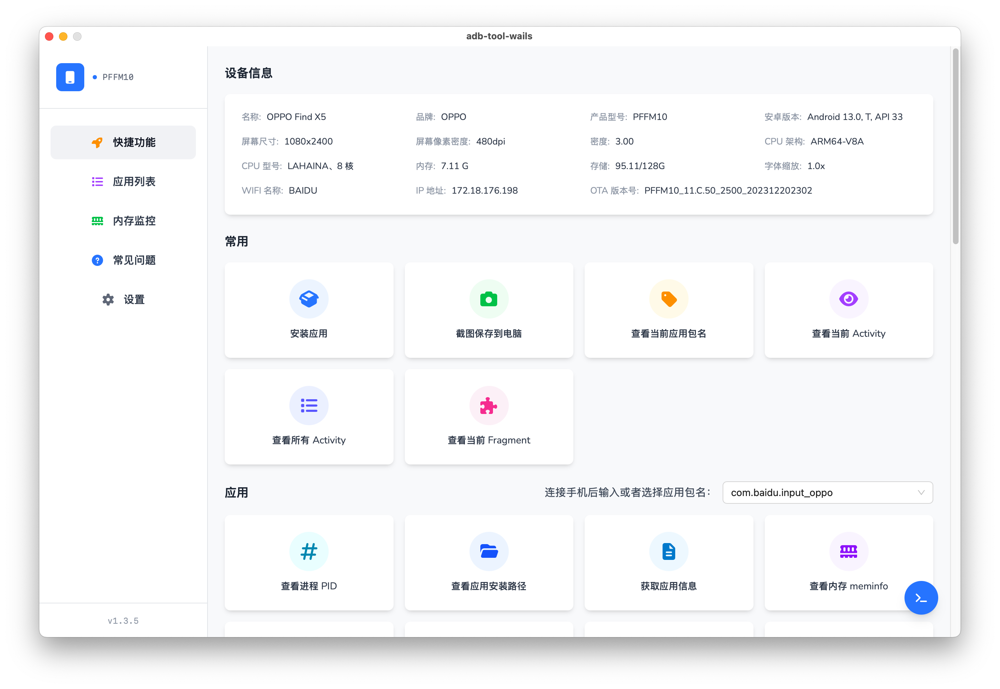
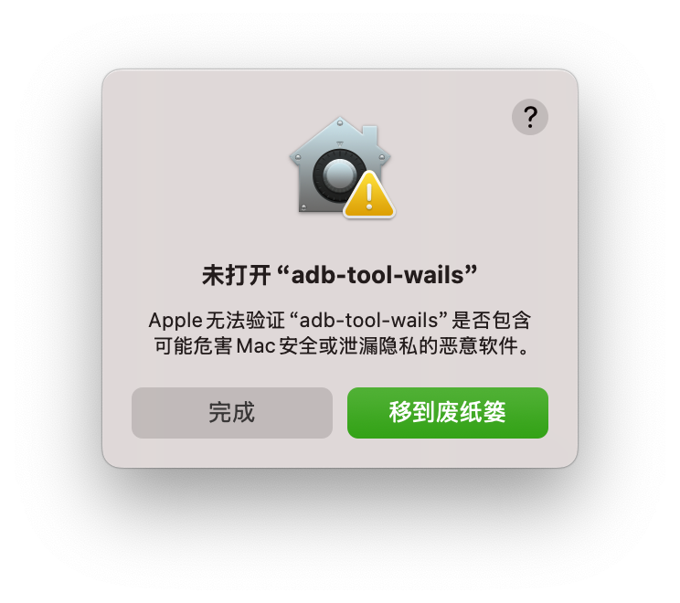
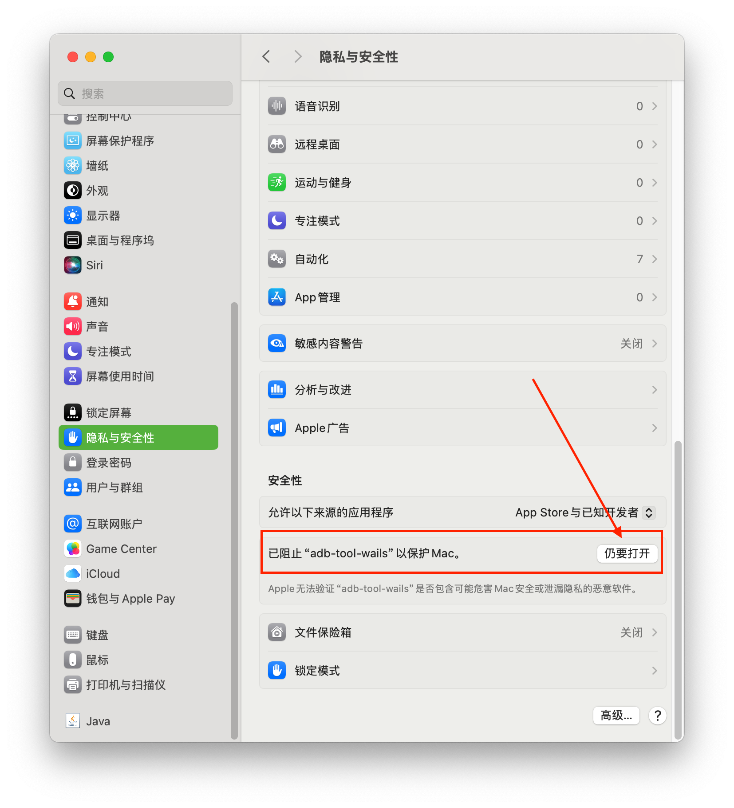

# ADB Tool

<div align="center">




一个现代化的 Android Debug Bridge (ADB) 图形界面工具，让 Android 设备调试与管理变得简单直观。

[](LICENSE)
[](https://wails.io)
[](https://golang.org)
[](https://reactjs.org)

[功能特性](#功能特性) • [快速开始](#快速开始) • [开发计划](#开发计划)

</div>




---

## 功能特性

### 设备连接
- **设备列表** - 实时显示已连接的设备，多台设备时可快速切换
- **设备信息** - 型号、Android 版本、屏幕、CPU、内存、存储、OTA 版本号等，点击即可复制
- **无线调试** - 支持二维码配对、配对码配对、IP 连接，以及将 USB 设备切换为无线调试（适用于 Android 10 及以下）

### 快捷功能
- **常用操作** - 安装 APK、截图保存到电脑、截图复制到剪贴板、查看当前 Activity / Fragment 等
- **应用操作** - 对目标应用执行启动、杀死、重启、清除数据、授予或重置权限、导出 APK、卸载等
- **调试导出** - 导出 meminfo、smaps、showmap、hprof、线程信息，查看线程优先级与可运行核
- **Deep Link 测试** - 用 VIEW Intent 打开链接，显示打开的 Activity 与启动耗时，可限定只由目标应用解析
- **快捷设置** - GPU 呈现模式、过度绘制、布局边界，以及开发者选项、WLAN、语言等系统设置页
- **按键与系统** - HOME、返回、音量等按键，查看系统属性、重启、关机

### 应用列表
- 查看设备上所有已安装的应用（用户应用 / 系统应用），支持按名称或包名搜索
- 显示版本、SDK、安装与更新时间、APK 路径、签名 SHA256
- 每个应用可直接启动、进入性能监控、设为快捷功能的目标应用、导出 APK 或卸载
- 选中设备后在后台预加载，打开页面即可查看

### 性能监控
- 同时监控包名下的所有进程（主进程与 `:push` 等子进程），无需 root，Release 包可用
- **内存** - PSS 分类、匿名内存与 Swap、Objects 计数（Activities、Views 等），可查看任意时刻的完整 meminfo
- **CPU** - 进程占用（单核口径）与整机占用，悬停显示最耗 CPU 的线程，以及单核负载
- **频率与温度** - 各核簇的区间平均频率、CPU 温度与降频阈值
- **进程事件** - 自动检测进程启动、退出、重启与 ANR，并给出原因（如低内存、崩溃、强制停止），在图表上标注
- 支持导出 CSV

### 文件管理
- 浏览设备文件，预览文本与图片，上传、下载、删除，收藏常用目录
- 拖入文件即可上传到当前目录

### 其他
- **拖拽安装** - 把 APK 拖进窗口即可安装，版本降级时会提示确认后卸载重装
- **深色模式** - 跟随系统、浅色、深色三种外观
- **应用内更新** - 启动时检查 GitHub Releases，在后台下载新版本，重启即可完成更新；会使用系统代理，下载中断时自动重试并续传。macOS 上通过应用内更新安装的新版本不会再触发「无法验证开发者」的提示
- **诊断日志** - 查看与导出应用自身的运行日志，便于反馈问题

---
## 开发计划

### 近期计划
- 首次启动引导：检测 adb、设备连接与 USB 调试授权，按步骤引导完成配置
- 屏幕录制 - 录制设备屏幕操作
- 分析 hprof 文件：View、Activity 的个数以及其到 GC Root 的引用链、加载的类等

---
## 快速开始

### 前置要求

- **ADB** - 确保系统已安装 Android Debug Bridge
    - Windows: [下载 Platform Tools](https://developer.android.com/tools/releases/platform-tools)
    - macOS: `brew install android-platform-tools`
    - Linux: `sudo apt install android-tools-adb`

- **USB 调试** - 在 Android 设备上启用 USB 调试
    1. 进入 **设置** → **关于手机**
    2. 连续点击 **版本号** 7 次启用开发者选项
    3. 返回 **设置** → **开发者选项** → 启用 **USB 调试**

- **无线调试（可选）** - Android 11 及以上可在 **开发者选项** → **无线调试** 中开启，然后在应用左侧点击「无线连接」配对。二维码配对依赖 mDNS，电脑与手机不在同一网段时请使用配对码配对

### 安装

#### 方式 1: 下载预编译版本
访问 [Releases 页面](https://github.com/ilpanda/adb-tool-wails/releases) 下载适合你系统的版本：

- **Windows**: `adb-tool-windows-amd64-installer.zip`
- **macOS**: `adb-tool-macos-universal.tar.gz`
- **Linux**: `adb-tool-linux-amd64.tar.gz`

##### macOS 首次运行
解压 `adb-tool-macos-universal.tar.gz` 后，将应用移动到「应用程序」中。

由于应用未经过 Apple 公证，macOS 首次打开时会显示安全提示，按以下步骤操作（之后通过应用内更新升级不会再出现）：

**第 1 步**：首次打开应用时，系统会弹出无法验证的提示，点击「完成」关闭对话框



**第 2 步**：点击左上角苹果图标，选择「系统设置...」

**第 3 步**：进入「隐私与安全性」，在安全性区域找到被阻止的应用，点击「仍要打开」，输入密码确认安装。




#### 方式 2: 从源码构建
```bash
# 克隆仓库
git clone https://github.com/ilpanda/adb-tool-wails.git
cd adb-tool-wails

# 安装依赖
go mod download
cd frontend && npm install && cd ..

# 构建
wails build

# 运行（macOS 为 build/bin/adb-tool-wails.app）
./build/bin/adb-tool-wails
```

#### 方式 3: 本地调试
本地运行 wails：
```bash
wails dev
```
如果本地修改 aya server ，需要再次编译：
```bash
# 在项目根目录下执行
cd server
./gradlew :server:assembleRelease
```
编译后会自动替换 resources 目录下的 aya.dex，记得修改：
- server/server/build.gradle 文件中的 versionName、versionCode
- internal/aya/client.go 中的 AyaDexVersion

---
### 参考
本仓库代码实现参考了以下多个仓库：
1. https://github.com/liriliri/aya
2. https://github.com/wkbin/AdbFileManager
3. https://github.com/EaniaHuui/android_tool
